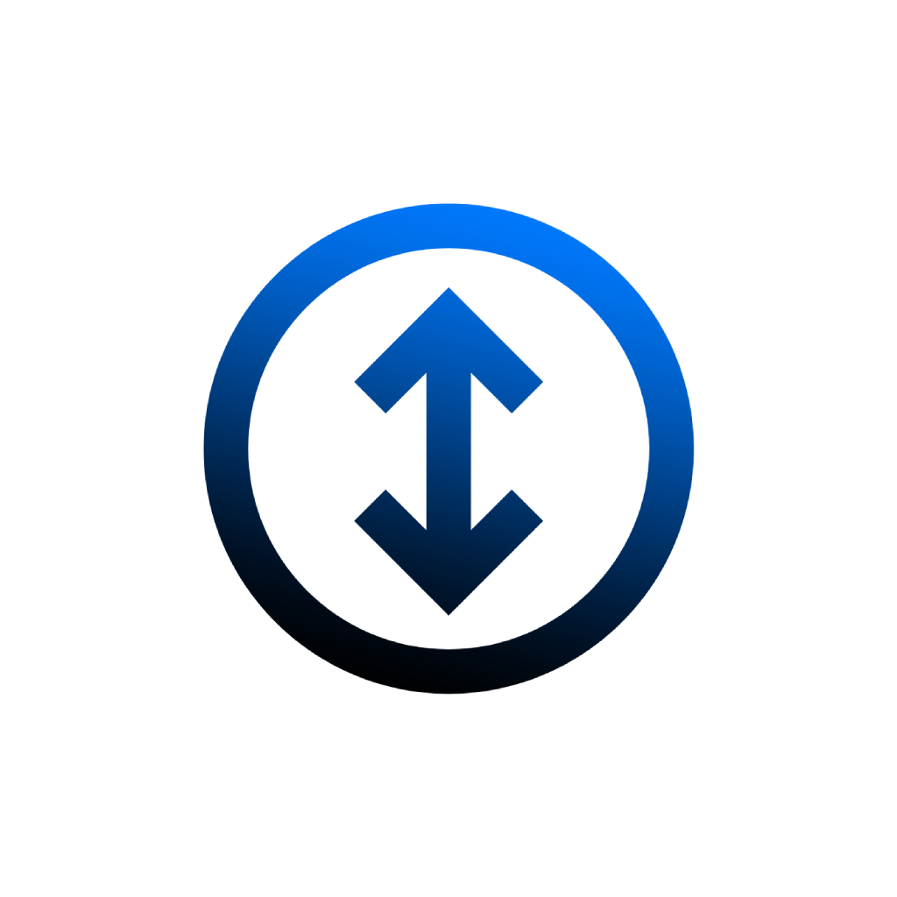

# Scrollapp

[](https://github.com/fromis-9/scrollapp/releases)

A macOS utility that brings Windows-style auto-scrolling to macOS. Middle-click over the page or document you want to scroll, then move your pointer to control speed and direction.



## Features

- **Auto-scrolling**: Activate with configurable mouse/key combinations, move cursor to control scrolling
- **8 Activation Methods**: Choose from middle-click, hold, modified clicks, side buttons, or double-click
- **Trackpad Support**: Option+Scroll activation for trackpad users
- **Adjustable Sensitivity**: Slider control from 0.1x to 3.0x speed with exponential slow-speed scaling
- **Constant Speed**: Start scrolling immediately at 1, 2, 4, 8, 16, 32, 64, or 128 pixels per second
- **Scroll Indicator**: In Follow Pointer mode, the scroll cursor replaces the normal pointer and highlights the active direction in blue. At a constant speed, the indicator stays at the starting point.
- **Optional Horizontal Scrolling**: Move left or right for sideways scrolling, or move diagonally to scroll on both axes
- **Customizable Direction**: Option to invert scrolling direction based on preference
- **Launch at Login**: Optional automatic startup
- **Menu Bar Integration**: Quick access via status menu in the menu bar

## Installation

1. Download `Scrollapp-v1.3.1.zip` from the [latest GitHub release](https://github.com/fromis-9/scrollapp/releases/latest).
2. Unzip the download, drag Scrollapp into **Applications**, and open it from there.
3. Grant **Accessibility** access when prompted. On macOS Ventura or later, go to **System Settings → Privacy & Security → Accessibility**. On Big Sur or Monterey, go to **System Preferences → Security & Privacy → Privacy → Accessibility**.
4. If macOS also prompts for **Input Monitoring**, enable Scrollapp in that section. You can check both permissions from **Settings → Permissions…** in the Scrollapp menu. Quit and reopen Scrollapp after changing permissions.

To update an existing copy, choose **Quit** in the Scrollapp menu, drag the new copy into **Applications**, choose **Replace** when Finder asks, then reopen Scrollapp.

## How to Use

### Activating Auto-scroll

**With Mouse (Configurable):**
Choose your preferred activation method from the menu bar:
- **Middle Click** (default)
- **Middle Click (Hold)**
- **Shift + Middle Click**
- **Cmd + Middle Click**
- **Option + Middle Click**
- **Mouse Button 4** (side button)
- **Mouse Button 5** (side button)
- **Double Middle Click**

Use your chosen method to toggle auto-scroll on and off. Clicking another mouse button also stops scrolling, except that a left click can keep it running when **Keep Scrolling on Left Click** is enabled.
With **Middle Click (Hold)**, press and hold the middle button to scroll, then release it to stop.
Plain **Middle Click** leaves links alone when the app exposes them through macOS Accessibility.

**With Trackpad:**
- Hold Option key and perform a two-finger scroll to activate auto-scroll
- Turn off **Activation Method → Option + Scroll** to leave Option-scroll gestures to the current app
- When **Horizontal Scrolling** is enabled, an Option + two-finger sideways gesture also activates it
- Right-click or choose **Stop Auto-Scroll** in the menu bar to exit auto-scroll mode

### Scroll Mode

**Follow Pointer**

Choose **Scroll Mode → Follow Pointer** to steer with the mouse.

Auto-scroll stops when you leave the current window, enter the menu bar, switch apps, or switch desktops.

- Move cursor **up** to scroll **up**
- Move cursor **down** to scroll **down**
- Enable **Horizontal Scrolling** to scroll left, right, or diagonally
- Move further from the starting point for faster scrolling
- Near the starting point, use small movements to adjust speed and direction
- After moving farther away, move about 16 points back to reverse from your current position
- Near the edge of a display, full speed takes less pointer travel

**Constant speed**

Choose a preset like **Scroll Mode → 8 px/s** (8 pixels per second). Use your activation shortcut to start scrolling down immediately, even with the pointer still. To scroll up, enable **Settings → Invert Scrolling Direction**. Use the same shortcut or choose **Stop Auto-Scroll** to stop. With **Middle Click (Hold)**, release the button to stop.

### Customization

**Pointer Sensitivity**

- Use the sensitivity slider in the menu (0.1x to 3.0x). It appears in **Follow Pointer** mode.
- Speeds below 1.0x use exponential scaling for fine control
- Real-time adjustment with immediate feedback

**Activation Method:**
- Choose from 8 different mouse/key combinations
- Avoid conflicts with browser middle-click link opening
- Supports modifier keys (Shift, Cmd, Option) and side buttons

### Menu Options

Access additional options from the menu bar icon:
- **Start Auto-Scroll** or **Stop Auto-Scroll** - Manual toggle with an active menu bar indicator
- **Pointer Sensitivity** - Sensitivity slider in Follow Pointer mode
- **Scroll Mode** - Choose **Follow Pointer** or a constant speed in pixels per second
- **Activation Method** - Choose a mouse shortcut or toggle **Option + Scroll**
- **Settings**
  - **Horizontal Scrolling** - Enable sideways and diagonal scrolling
  - **Invert Scrolling Direction** - Reverse scrolling on both axes
  - **Show Auto-Scroll Indicators** - Show the click-through indicator while scrolling
  - **Keep Scrolling on Left Click** - Left-click while auto-scroll continues
  - **Hide Menu Bar Icon** - Reopen Scrollapp from Finder or Spotlight to bring the menu back until you dismiss it
  - **Launch at Login** - Automatic startup option
  - **Permissions…** - Check Accessibility and Input Monitoring and open the corresponding macOS settings
- **About Scrollapp** - View the installed version, a quick guide to Scroll Mode, and links to the website and GitHub
- **View Latest Release…** - Open the latest GitHub release in your browser

## System Requirements

- macOS 11.0 (Big Sur) or later
- Mouse with middle button, side buttons, or trackpad support
- Compatible with both Intel and Apple Silicon Macs

## Privacy & Security

- **Permissions**. Scrollapp uses Accessibility to send scroll events and detect links. Input Monitoring lets it observe mouse and trackpad gestures in other apps when macOS requires it.
- **Data**. Scrollapp processes mouse and trackpad input on your Mac. **View Latest Release…** opens GitHub Releases in your browser.
- **Code signing**. Official downloads are signed with an Apple Developer ID certificate.

## License

[GNU General Public License v3.0](LICENSE)

## Building from Source

With Xcode installed, clone the repository and run the universal build script.

```bash
git clone https://github.com/fromis-9/scrollapp.git
cd scrollapp
bash scripts/build_universal.sh CODE_SIGNING_ALLOWED=NO
```

The build writes `build/universal/Scrollapp.app` for Intel and Apple silicon. To work in Xcode, open `Scrollapp.xcodeproj` and select the **Scrollapp** scheme. See the [build scripts](scripts/README.md) for signing options and local test packaging.

## Feedback and Contributions

Feedback and contributions are welcome! Please feel free to submit issues or pull requests.
